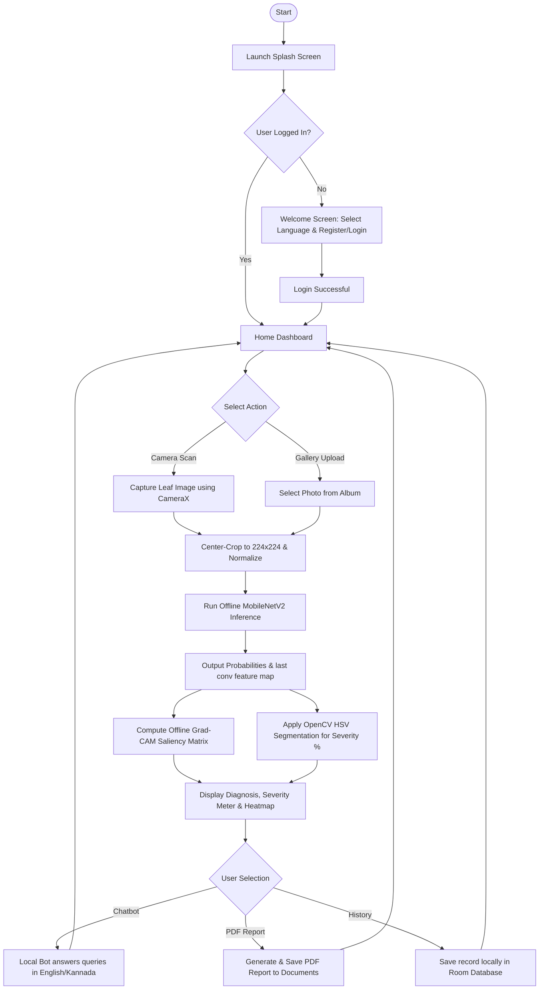
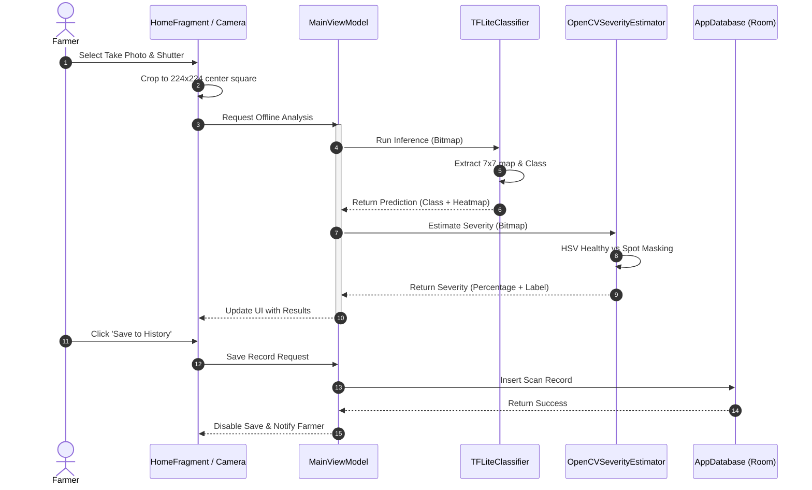
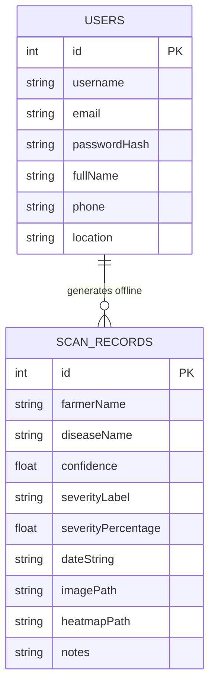
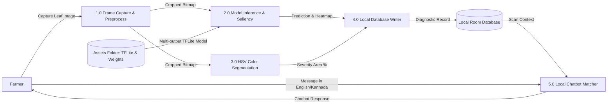

# Technical Project Documentation: Offline Rubber Leaf Disease Diagnosis & Explainable AI System

An AI-powered, native Android mobile application developed in Kotlin, OpenCV, and TensorFlow Lite. The system enables small-scale rubber plantation owners in Karnataka to diagnose, measure, and log leaf diseases completely offline, with explainable AI saliency maps and localized Kannada/English voice assistance.

---

## 📖 Table of Contents
1. [Project Overview & Key Technical Features](#1-project-overview--key-technical-features)
2. [Software Stack & Hardware Requirements](#2-software-stack--hardware-requirements)
3. [System Architecture & Directory Structure](#3-system-architecture--directory-structure)
4. [Machine Learning Pipeline & Model Serialization](#4-machine-learning-pipeline--model-serialization)
5. [Computer Vision & Explainable AI (XAI) Algorithms](#5-computer-vision--explainable-ai-xai-algorithms)
6. [Out-of-Distribution (OOD) & Warning Mechanisms](#6-out-of-distribution-ood--warning-mechanisms)
7. [App Component Walkthrough](#7-app-component-walkthrough)
8. [UML Diagrams (Mermaid.js)](#8-uml-diagrams-mermaidjs)
9. [Setup, Clean & Build Guide](#9-setup-clean--build-guide)

---

## 1. Project Overview & Key Technical Features

The application addresses critical challenges faced by small-scale rubber farmers: lack of internet connectivity, language barriers, and difficulty identifying diseases early. Key features include:

- **Offline Machine Learning Classifier**: A customized, multi-output MobileNetV2 classifier evaluating 9 distinct states (8 organic leaf states + 1 background/non-leaf state) in under 50ms on standard CPUs.
- **Explainable AI (Grad-CAM)**: On-device generation of localized heatmap overlays showing exactly where the neural network is focusing on the leaf (e.g. necrotic spots, powdery patches).
- **On-Device Severity Estimation**: OpenCV HSV (Hue, Saturation, Value) range-based segmentation calculating the ratio of infected leaf surface area to healthy green leaf surface area.
- **Room SQLite Local Database**: Fully offline logging of all farmer diagnoses, dates, severities, and image paths, with history searching and gestural swipe-to-delete support on both recent and full logs list.
- **Localized Voice Assistant / Chatbot**: A completely on-device, regular expression and keyword-matching chatbot in English and Kannada, integrating Text-to-Speech (TTS) for hands-free farmer assistance.
- **On-Device PDF Report Generator**: Exports official diagnostic reports (containing farmer profiles, date stamps, OpenCV severity percentages, treatment recommendations, and original leaf images) with interactive Open/Share intents via a native `FileProvider` channel.
- **Out-of-Distribution (OOD) Safe Intercept**: Intercepts non-leaf or noisy uploads (e.g., photos of rooms, hands, random objects) and displays warning cards to prevent false classifications.

---

## 2. Software Stack & Hardware Requirements

### Hardware Requirements
- **Mobile Device**: Android device running Android 7.0 (API Level 24) or higher.
- **RAM**: Minimum 3GB (4GB+ recommended).
- **Camera**: Autofocus rear camera (8MP+).
- **Disk Space**: ~150MB of internal storage.

### Software Stack
- **Languages**: Kotlin (Android Frontend/Backend), Python 3.12 (Model training/conversion).
- **UI Framework**: Native Android XML (Material Design 3).
- **Libraries & API Tools**:
  - **CameraX**: High-performance, lifecycle-aware camera capture.
  - **Room Persistence Library**: Offline SQLite database abstraction.
  - **TensorFlow Lite**: On-device neural network inference runner.
  - **OpenCV Android SDK**: Native C++ HSV color segmentation and image manipulation.
  - **Android Text-To-Speech (TTS)**: Localized speech generation.
  - **Android PdfDocument**: Native canvas drawing and PDF compiling.

---

## 3. System Architecture & Directory Structure

The project implements the standard **MVVM (Model-View-ViewModel)** architectural pattern:

```text
com.rubber.disease/
│
├── activities/
│   └── MainActivity.kt               # Main entry activity (handles locale, theme)
│
├── ui/
│   ├── fragments/
│   │   ├── SplashFragment.kt         # Splash onboarding delay router
│   │   ├── WelcomeFragment.kt        # Language picker (English/Kannada) & user route
│   │   ├── LoginFragment.kt          # User credential auth
│   │   ├── RegisterFragment.kt       # Room USERS database insertion
│   │   ├── HomeFragment.kt           # Dashboard (Camera/Gallery buttons, recent logs)
│   │   ├── PredictionFragment.kt     # Main diagnostics display, TTS trigger, warning cards
│   │   ├── SeverityFragment.kt       # OpenCV HSV output visualizer
│   │   ├── GradCamFragment.kt        # Explainable AI heatmap viewer
│   │   ├── RecommendationFragment.kt # Localized treatment rules & speech synthesis
│   │   └── ChatbotFragment.kt        # Local English/Kannada agricultural expert chatbot
│   │
│   └── adapters/
│       └── HistoryAdapter.kt         # Recycler view adapter for Room scan records
│
├── data/
│   ├── UserDao.kt                    # User profile registration database interfaces
│   ├── ScanRecordDao.kt              # Scan log database CRUD interfaces
│   ├── AppDatabase.kt                # Room database main abstract class
│   ├── UserEntity.kt                 # USERS schema definitions
│   └── ScanRecordEntity.kt           # SCAN_RECORDS schema definitions
│
├── ml/
│   ├── TFLiteClassifier.kt           # Direct ByteBuffer inputs/outputs inference runner
│   └── OpenCVSeverityEstimator.kt    # OpenCV HSV color ranges segmentation pipeline
│
└── utils/
    ├── GradCamUtils.kt               # Bilinear interpolation heatmap color-mapping
    ├── LanguageHelper.kt             # Runtime language locale override context wrapper
    ├── TextToSpeechHelper.kt         # Application-level speech synthesis helper
    └── PdfGenerator.kt               # Native PDF canvas coordinate drawing writer
```

---

## 4. Machine Learning Pipeline & Model Serialization

The model is built on top of **MobileNetV2** (pre-trained on ImageNet) to extract features efficiently under mobile CPU constraints.

### Pre-inference Image Preprocessing & Validation
Before sending the captured image to the TFLite model, the app routes it through an on-device OpenCV preprocessor to clean the inputs and filter out invalid/low-quality uploads:

1. **Leaf Detection & Segmentation**:
   - Segment the organic leaf surface using combined HSV masks (healthy green + senescent yellow-brown + necrotic dark/white spots).
   - Extract the largest contour boundary, crop the image to its bounding box, and mask out all surrounding background clutter (sets background to black).
2. **Quality Enhancement**:
   - **Illumination & Shadow Correction**: Applies CLAHE (Contrast Limited Adaptive Histogram Equalization) on the luminance (L) channel in Lab color space to remove lighting shadows and balance contrast.
   - **Bilateral Denoising**: Smooths camera sensor grain using a bilateral filter (which preserves the sharp margins of leaf spots and borders).
   - **Unsharp Mask Sharpening**: Enhances fine lesion details by blending the denoised image with a Gaussian blurred map.
   - **Normalizing Dimensions**: Resizes the final cropped, enhanced leaf to $224 \times 224$ pixels for TFLite inference.
3. **Rigid Quality Checks**:
   - **No Leaf / Too Small**: Rejects if no leaf contour is found, or if the largest contour covers less than $40\%$ of the image frame.
   - **Multiple Leaves**: Rejects if more than one significant leaf contour (covering $> 5\%$ of the frame) is present.
   - **Exposure Validation**: Rejects if the average luminance falls below $45.0$ (too dark) or goes above $225.0$ (overexposed).
   - **Blur Validation**: Evaluates camera focus using the Laplacian variance method. If variance is $< 30.0$, the image is flagged as blurry.
   - **Cropped Object**: Rejects if the leaf bounding box touches the outer edge of the frame, indicating the leaf is cut off.
4. **Classification & Confidence Check**:
   - Feeds the cleaned $224 \times 224$ image into the classifier.
   - If the predicted class confidence is below $80.0\%$, the prediction is intercepted and flagged with a low-confidence warning.

### Symbolic Graph Connection & Preprocessing
To ensure that the TensorFlow Lite converter traces the entire model graph correctly without weight mismatches or disconnected subgraphs during serialization, the model is constructed using the Keras Functional API:

1. **Pre-Processing Graph Integration**: The MobileNetV2 preprocessing layer (`preprocess_input`) is built directly into the input node of the model:
   $$\text{Preprocessed}(X) = \frac{X}{127.5} - 1.0$$
   This enables the model to take raw float inputs in the range $[0.0, 255.0]$ directly from the preprocessor's output bitmap byte buffers, removing double-preprocessing bugs.
2. **Functional Tracing**: The preprocessed tensor is passed symbolically through the base MobileNetV2 model to extract feature activations:
   $$F = \text{base\_model}(\text{Preprocessed}(X))$$
3. **1x1 Convolution Head**: To avoid the incompatible `FULLY_CONNECTED` version 12 operator generated by Keras Dense layers in TensorFlow 2.21+, the classification head is implemented as a **1x1 2D Convolution** (`Conv2D` with size $1\times1$). This compiles to the universally compatible `CONV_2D` operator:
   $$C = \text{Conv2D}(F)$$
   $$P = \text{Softmax}(\text{GlobalAveragePooling2D}(C))$$
   Mathematically, average pooling followed by a dense layer is identical to a 1x1 convolution followed by average pooling, preserving the exact target shape of $(1280, 9)$ for Grad-CAM weights.

### Weight Preservation & Model Conversion
To prevent Keras from resetting the classification layer weights during multi-output instantiation, the model weights are saved, a multi-output model is built, and the weights are reloaded before compilation:

```python
# 1. Save trained weights
temp_weights_path = "temp_weights.weights.h5"
model.save_weights(temp_weights_path)

# 2. Build inference model (Output 0: Softmax Class probabilities, Output 1: Base Feature Map)
inference_model = Model(inputs=inputs, outputs=[model.output, features_output])
inference_model.load_weights(temp_weights_path)

# 3. Serialize to TFLite
converter = tf.lite.TFLiteConverter.from_keras_model(inference_model)
tflite_model = converter.convert()
```

- **Output 0 (Classification probabilities)**: Shape $[1, 9]$
- **Output 1 (Feature Map activation)**: Shape $[1, 7, 7, 1280]$
- **Weights File (`dense_weights.bin`)**: Squeezed weight matrix of shape $[1280, 9]$ representing the trained parameters of the 1x1 Convolution classifier.

---

## 5. Computer Vision & Explainable AI (XAI) Algorithms

### On-Device Grad-CAM Activation Heatmaps
Grad-CAM (Gradient-weighted Class Activation Mapping) calculates the activation score of each spatial cell $(y, x)$ on the $7\times7$ grid for the predicted class $c$:

$$\text{Saliency}(y, x) = \text{ReLU} \left( \sum_{k=1}^{1280} W_{k, c} \cdot F_{y, x, k} \right)$$

Where:
- $F_{y, x, k}$ is the activation at row $y$, column $x$, and channel $k$.
- $W_{k, c}$ is the trained classification weight for channel $k$ and class $c$ extracted from `dense_weights.bin`.

#### Overlay Processing in Kotlin & OpenCV:
1. The $7\times7$ saliency matrix is converted to an OpenCV Mat `CvType.CV_32FC1`.
2. It is resized to match the original image bitmap dimensions using bilinear interpolation (`Imgproc.INTER_LINEAR`).
3. The matrix is scaled to `CV_8UC1` ($[0, 255]$ range).
4. The **JET Colormap** (`Imgproc.COLORMAP_JET`) is applied to map cold regions (low activations) to blue and hot regions (high activations) to red.
5. The original image and the RGB colormap are blended using:
   $$\text{Output} = \alpha \cdot \text{Original} + (1 - \alpha) \cdot \text{Colormap}$$
   (where $\alpha$ is set to $0.5$).

### OpenCV Disease Severity Estimation
Severity is calculated using color space segmentation. The input RGB bitmap is converted to Hue-Saturation-Value (HSV) format. HSV separates chromatic intensity from brightness, making it robust under field lighting conditions:

1. **Healthy Green Mask**:
   - Hue: $35.0 - 85.0$, Saturation: $30.0 - 255.0$, Value: $30.0 - 255.0$
2. **Yellow/Brown Disease Mask** (Anthracnose, Leaf Blight, Leaf Spot):
   - Hue: $10.0 - 35.0$, Saturation: $30.0 - 255.0$, Value: $30.0 - 255.0$
3. **Dark/Black Spot Mask** (Necrotic lesion centers):
   - Hue: $0.0 - 180.0$, Saturation: $0.0 - 255.0$, Value: $0.0 - 60.0$
4. **White/Grey Spot Mask** (Powdery Mildew):
   - Hue: $0.0 - 180.0$, Saturation: $0.0 - 50.0$, Value: $150.0 - 255.0$

$$\text{Diseased Mask} = \text{Mask}_{\text{Yellow/Brown}} \cup \text{Mask}_{\text{Dark}} \cup \text{Mask}_{\text{White}}$$
$$\text{Overall Leaf Mask} = \text{Mask}_{\text{Healthy}} \cup \text{Mask}_{\text{Diseased}}$$
$$\text{Severity Percentage} = \left( \frac{\text{CountNonZero}(\text{Diseased Mask})}{\text{CountNonZero}(\text{Overall Leaf Mask})} \right) \times 100\%$$

---

## 6. Out-of-Distribution (OOD) & Warning Mechanisms

To prevent farmers from scanning non-leaf objects (hands, soil, background objects) and receiving false diagnoses, the system operates a double-checkpoint verification pipeline:

1. **Color-Based Check (Leaf Ratio & Organic Content)**:
   The system runs two separate color-space segmentation checks to evaluate the presence of valid leaf tissue:
   - **Leaf Ratio**: If the total leaf pixel ratio (healthy green + diseased leaf pixels over total image pixels) is extremely low:
     $$\text{Leaf Ratio} < 12.0\%$$
   - **Organic Content Ratio**: If the sum of green and yellow-brown pixels (the actual organic tissue colors of a rubber leaf) relative to the total image size is extremely low:
     $$\text{Organic Ratio} < 8.0\%$$
   If **either** check fails, the image is flagged as invalid (intercepting non-organic grey/black laptop screens, keyboards, desks, or wall backgrounds).
2. **Shape-Based Check (Solidity & Size Contour)**:
   To intercept wide-angle long shots or complex background clutter (like grass, weeds, and branches), the system extracts the largest contour in the leaf mask and evaluates:
   - **Solidity**: Solidity measures how convex and closed the leaf shape boundary is. Since a rubber leaf has smooth entire borders, its solidity is high. If:
     $$\text{Solidity} < 65.0\%$$
     it flags highly complex background textures.
   - **Main Contour Area Ratio**: Computes the size of the largest contour relative to the image size. In a wide-angle photo, the leaf is small. If:
     $$\text{Main Contour Ratio} < 15.0\%$$
     the leaf is too far away or absent, and the image is intercepted.
3. **Inference Uncertainty Check**:
   If the maximum softmax class probability outputs a confidence score of:
   $$\text{Confidence} < 45.0\%$$
   The classification is intercepted, and the predicted class name is overridden to **`"Invalid / Non-Rubber Leaf"`**.
4. **Adaptive Interface Block**:
   - Shows a gray **`Invalid Image`** badge.
   - Hides the database "Save" button and PDF generator.
   - Replaces the disease list with a warnings card: *"Please capture a clear, close-up photo of a rubber leaf ⚠️"*.
   - Plays a localized TTS voice instruction asking the farmer to retake the photo.

---

## 7. App Component Walkthrough

- **Locale Context Wrapper**: Dynamically overrides base Android contexts on execution to apply selected localizations (English/Kannada) without restarting the system process.
- **Offline Room Database**: Persists diagnosis logs asynchronously inside coroutines using `ScanRecordEntity`. Provides LiveData streams to automatically update the dashboard recycler view, and supports full gestural swipe-to-delete capabilities across recent and full log history lists.
- **Hands-Free Recommendation TTS Engine**: Houses treatment suggestions locally. When a farmer views results, it synthesizes speech in their local language, enabling hands-free field operations.
- **On-Device Chatbot Assistant**: Uses regular expressions and keywords to parse questions (e.g., about fertilizer doses, treatment recipes, or disease symptoms) and returns localized advice from the Room diagnostic logs.
- **Native PDF Layout Canvas Compiler**: Uses Android's native `PdfDocument` to paint text and images at absolute coordinate points. It wraps description strings automatically using a bounding box text-paint block, outputting a high-fidelity document without external dependencies, and integrates with Android's `FileProvider` to instantly trigger interactive VIEW or SEND intents for the resulting PDF.

---

## 8. UML Diagrams (Mermaid.js)

### Use Case Diagram
```mermaid
usecaseDiagram
    actor Farmer
    actor "Agricultural Expert" as Expert
    
    Farmer --> (Register / Create Profile)
    Farmer --> (Perform Leaf Scan via Camera/Gallery)
    Farmer --> (View Diagnostic Report & Grad-CAM Heatmap)
    Farmer --> (View Treatment & Fertilizer Recommendations)
    Farmer --> (Ask Local AI Chatbot in Kannada/English)
    Farmer --> (Export PDF Report)
    Farmer --> (View History Log)
    
    Expert --> (Provide Consultations)
    (View Diagnostic Report & Grad-CAM Heatmap) ..> Expert : Share Report
```

### System Flowchart


### Sequence Diagram


### Entity Relationship (ER) Diagram


### Data Flow Diagram (DFD - Level 1)


---

## 9. Setup, Clean & Build Guide

To deploy, compile, or debug the code from scratch on any computer with Android Studio:

### 1. Clear Cache & Clean Project
Android Studio caches compiled assets inside its intermediates directories. To ensure that old models and dependency conflicts are resolved, clean the project directories:
- Select **Build > Clean Project** from the top menu, or run in the project terminal:
  ```powershell
  .\gradlew.bat clean
  ```

### 2. Sync Gradle Files
Force Android Studio to resolve the Room database compiler, CameraX modules, and the correct stable TensorFlow Lite `2.14.0` libraries:
- Select **File > Sync Project with Gradle Files**.

### 3. Rebuild & Run
- Click **Build > Rebuild Project**.
- Connect your target test device (or open the emulator) and click the green **Run 'app'** play button (or press `Shift` + `F10`).
