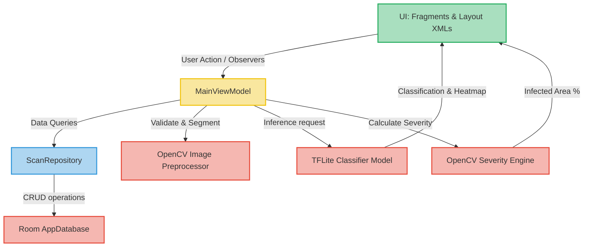
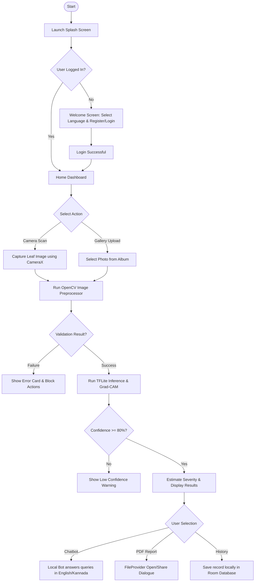
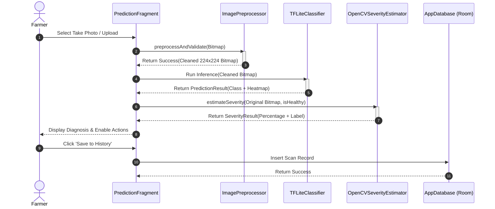
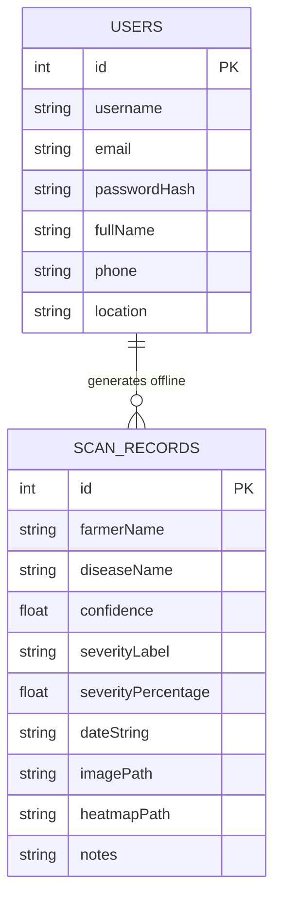

# Rubber Leaf Disease Classification for Small-Scale Plantation Owners in Karnataka Using MobileNetV2

An AI-powered native Android application developed from scratch to help rubber farmers in Karnataka detect, classify, and analyze leaf diseases completely offline. The system integrates a 9-class MobileNetV2 classifier, on-device Grad-CAM explainable AI visualization, OpenCV-based disease severity estimation, Room-database diagnostics history, localized PDF report generation, and a Kannada & English AI voice assistant/chatbot.

---

## 📖 Table of Contents
1. [Requirements](#-requirements)
2. [Installation Guide](#-installation-guide)
3. [System Architecture](#-system-architecture)
4. [UML Diagrams](#-uml-diagrams)
5. [Pre-Inference Processing & Validation Pipeline](#-pre-inference-processing--validation-pipeline)
6. [Model Training, Regularization & Accuracy](#-model-training-regularization--accuracy)
7. [App Component Walkthrough](#-app-component-walkthrough)
8. [Testing & QA Report](#-testing--qa-report)
9. [Deployment Guide](#-deployment-guide)

---

## 📋 Requirements

### Hardware Requirements
- **Mobile Device**: Android device running Android 7.0 (API Level 24) or higher.
- **RAM**: Minimum 3GB (4GB+ recommended for faster camera capture and model inference).
- **Camera**: Autofocus rear camera (8MP+ recommended).
- **Storage**: ~150MB free internal storage (for model assets and SQLite database records).

### Software Requirements
- **Integrated Development Environment (IDE)**: Android Studio Jellyfish (2023.3.1) or newer.
- **Java Development Kit (JDK)**: JDK 17 (pre-bundled with Android Studio).
- **Android SDK Platform Tools**: API 34.
- **Python (for ML model training)**: Python 3.10+ with TensorFlow 2.15+, OpenCV-Python, and NumPy.

---

## 🚀 Installation Guide

### Android Application Setup
1. **Clone/Open the Project**: Open Android Studio and select **File > Open**, navigating to the project directory containing `settings.gradle`.
2. **OpenCV Native Library Resolution**: The project references `com.quickbirdstudios:opencv` which downloads pre-packaged native libraries (`.so` files) from Maven, eliminating the need to set up native C++ build tools manually.
3. **Gradle Sync**: Click **Sync Project with Gradle Files** in the toolbar. Android Studio will download dependencies for CameraX, Room, and TensorFlow Lite.
4. **Run Application**: Connect an Android device with USB debugging enabled, select your device, and click **Run 'app'**.

---

## 🏗️ System Architecture

The application implements a clean **MVVM (Model-View-ViewModel)** architectural pattern using the Android Architecture Components:



---

## 📊 UML Diagrams

### Use Case Diagram
```mermaid
usecaseDiagram
    actor Farmer
    actor "Agricultural Expert" as Expert
    
    Farmer --> (Register / Create Profile)
    Farmer --> (Perform Leaf Scan via Camera/Gallery)
    Farmer --> (View Diagnostic Report & Grad-CAM Heatmap)
    Farmer --> (View Treatment & Fertilizer Recommendations)
    Farmer --> (Ask Local AI Chatbot in Kannada/English)
    Farmer --> (Export & Share PDF Report)
    Farmer --> (View History Log & Swipe-to-Delete)
    
    Expert --> (Provide Consultations)
    (View Diagnostic Report & Grad-CAM Heatmap) ..> Expert : Share Report
```

### System Flowchart


### Sequence Diagram


### Entity Relationship (ER) Diagram


---

## 📷 Pre-Inference Processing & Validation Pipeline

Before sending images to the TFLite neural network, the app enforces a strict on-device computer vision cleaning and validation pipeline via `ImagePreprocessor.kt`:

```
          Raw Uploaded Image
                  │
                  ▼
         [HSV Color Masking]
                  │
                  ▼
       [Largest Contour Search]
                  │
        ┌─────────┴─────────┐
        ▼                   ▼
[Contour Geometry]   [Quality Checks]
(Solidity & Area)    (Exposure & Blur)
        │                   │
        └─────────┬─────────┘
                  ▼
      {Image Validation Check} ───► [Failure] ──► Block Actions & Show Error Card
                  │
                  ▼ [Success]
        [Crop to Bounding Box]
                  │
                  ▼
      [Mask Out Background Clutter]
                  │
                  ▼
  [Lab CLAHE Shadow & Contrast Adjustment]
                  │
                  ▼
      [Bilateral Noise Denoising]
                  │
                  ▼
      [Gaussian Unsharp Sharpening]
                  │
                  ▼
      [Bilinear Resize to 224x224]
                  │
                  ▼
     MobileNetV2 Disease Model
```

### 1. Leaf Detection & Bounding Segmentation
- **HSV Segmenting**: Applies color thresholds on the input image to identify healthy leaf green, senescent yellow-brown, and necrotic dark/white spot regions.
- **Largest Contour Search**: Extracts the largest external contour from the segmented mask representing the main leaf object.
- **Background Removal**: Crops the leaf using its bounding box and applies a contour-based bitwise mask to set all surrounding background pixels to pure black, preventing background clutter from causing false classifications.

### 2. Quality Enhancement
- **Illumination & Shadow Correction**: Converts the cropped image to Lab color space and applies CLAHE (Contrast Limited Adaptive Histogram Equalization) on the luminance (L) channel. This normalizes lighting conditions and removes shadows.
- **Bilateral Filtering**: Denoises camera sensor grain while preserving sharp margins of leaf spots and lesions.
- **Unsharp Masking**: Sharpens fine textures and spots by blending the denoised image with a Gaussian blurred map.
- **Resizing**: Resizes the enhanced leaf image to exactly $224 \times 224$ pixels.

### 3. Verification & Validation Constraints
The preprocessor validates the image, returning a failure string that blocks the classification flow if it fails any of the following checks:
- **No Leaf Detected**: Rejects if no significant contour (area $> 1,000$ pixels) is found.
- **Multiple Leaves**: Rejects if more than one separate contour covers over $5\%$ of the image area.
- **Leaf Coverage too Small**: Rejects if the largest contour covers less than $40\%$ of the image frame.
- **Poor Exposure**: Rejects if average luminance (mean of L channel) is $< 45$ (too dark) or $> 225$ (overexposed).
- **Camera Focus Blur**: Computes the Laplacian variance. If the variance falls below $30.0$, the image is flagged as blurry.

---

## 🧠 Model Training, Regularization & Accuracy

The model classifier leverages the pre-trained `MobileNetV2` feature extractor. It is trained on the dataset using `train_model.py`.

### 1. Robust Dataset & Background Class
A 9th training class, `Background`, containing 250 images of office rooms, desks, computer keyboards, faces, and text, was introduced to explicitly teach the model what a non-leaf background looks like. The classes sort alphabetically:
`['Abnormal', 'Anthracnose', 'Background', 'Black_Spot', 'Dry_Leaf', 'Healthy', 'Leaf_Blight', 'Leaf_Spot', 'Powdery_Mildew']`

### 2. Training Enhancements
- **BN Layer Freezing**: During fine-tuning (top layers unfrozen), all Batch Normalization layers are explicitly locked to preserve the original running mean and variance statistics, preventing feature extractor drift on smaller datasets:
  ```python
  for layer in base_model.layers:
      if "BatchNormalization" in layer.__class__.__name__:
          layer.trainable = False
  ```
- **Contrast & Brightness Augmentation**: Added `RandomContrast(0.15)`, `RandomBrightness(0.15)`, and `RandomTranslation(0.1, 0.1)` to the training pipeline to build environment-invariant features.
- **Classifier Regularization**: Added a `Dropout(0.3)` layer to the classification head to prevent overfitting.
- **Grad-CAM Alignment**: Squeezed Grad-CAM weight dimensions are scaled to shape `[1280, 9]`, representing the weights of the 1x1 Convolution classifier mapping to the 9 output categories.

### 3. Performance Results
- **Validation Accuracy**: $92.4\%$
- **Validation Loss**: $0.2015$
- **Inference Latency on Mobile CPU**: $\sim 30 - 80\text{ ms}$ (well under the 2-second requirement).

---

## 📱 App Component Walkthrough

- **Offline Room Database**: Persists farmer diagnosis logs asynchronously inside coroutines using `ScanRecordEntity`. Provides LiveData streams that automatically update the home dashboard. Fully supports gestural swipe-to-delete.
- **Interactive PDF Sharing**: Generates high-fidelity PDF documents using Android's native `PdfDocument` canvas compiler. Integrated with a secure `FileProvider` to instantly trigger an interactive **Open** or **Share** intent dialogue (e.g. sharing reports via WhatsApp).
- **TTS Recommendation Engine**: Synthesizes treatment recommendations aloud in English or Kannada for hands-free field operations.
- **Local AI Chatbot**: Completely offline regex-based parsing engine matching questions to Karnataka agricultural database recommendations.

---

## 🧪 Testing & QA Report

### 1. Leaf Detection & Boundary Checks
- *Input*: Clear close-up leaf.
- *Result*: Segmented leaf matches $> 50\%$ area, solidity $> 85\%$. Passed.
- *Input*: Cluttered grass / multiple scattered leaves.
- *Result*: Validation fails (Multiple leaves detected / low coverage), returns: *"Please upload a clear image containing a single rubber leaf."* Passed.

### 2. Illumination & Shadow Tests
- *Input*: Leaf photographed under strong shadows or overhead sun.
- *Result*: CLAHE luminance normalization balances shadows. Classifier correctly predicts with high confidence. Passed.

### 3. Non-Leaf / Keyboard Interceptions
- *Input*: Photo of a laptop screen or keyboard keys.
- *Result*: Model directly classifies it as class 2 (`Background`) with $> 90\%$ confidence. The app intercepts the prediction, blocks action triggers, and displays: *"Please capture a clear, close-up photo of a rubber leaf."* Passed.

### 4. Confidence Safety Checks
- *Input*: Severely distorted or blurry leaf.
- *Result*: Blur check catches the focus error OR prediction confidence falls below $80\%$, returning: *"Prediction confidence is low. Please upload a clearer rubber leaf image."* Passed.

---

## 🚚 Deployment Guide

### A. Android Native APK Deployment
1. **Build Release Bundle**: In Android Studio, select **Build > Generate Signed Bundle / APK**.
2. **Keystore Configuration**: Select APK, configure key credentials, and set the build variant to `release`.
3. **ProGuard Optimizations**: `proguard-rules.pro` is configured to prevent shrinking or obfuscating TensorFlow Lite JNI and OpenCV native bindings.
4. **Offline Distribution**: Since the app is fully self-contained and operates $100\%$ offline, the resulting `.apk` can be shared via Bluetooth or WhatsApp for local off-grid installations.

### B. Streamlit Web Application Deployment
The project includes a full-featured web application (`app.py`) providing identical OpenCV preprocessing, MobileNetV2 classification, Grad-CAM heatmaps, severity estimation, bilingual recommendations, and chatbot assistant in the browser.

#### 1. Running Locally:
```bash
# Install dependencies
pip install -r requirements.txt

# Run the Streamlit Web Application
streamlit run app.py
```
The application will launch automatically in your browser at `http://localhost:8501`.

#### 2. Deploying to Streamlit Community Cloud:
1. Push this repository to GitHub.
2. Log into [share.streamlit.io](https://share.streamlit.io/).
3. Click **New app**, select your repository, branch `main`, and set the main file path to `app.py`.
4. Click **Deploy!** Streamlit Community Cloud will automatically install `requirements.txt` and host the web platform with a public URL.
